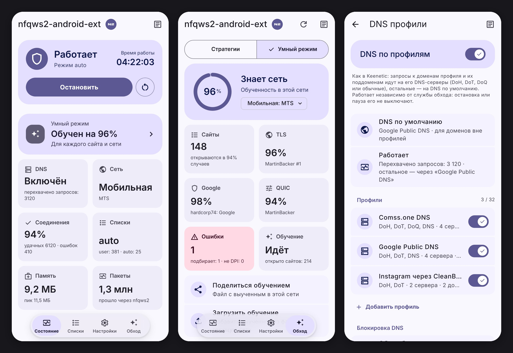

# nfqws2-android-ext

Полнофункциональный порт **nfqws2** ([zapret2](https://github.com/bol-van/zapret) от bol-van) с поддержкой синтаксиса стратегий Keenetic для Android.

Модуль предназначен для обхода ТСПУ/DPI **нативно на уровне ядра** через подсистему `netfilter` (NFQUEUE). В отличие от VPN-приложений (V2Ray, ByeDPI и др.), этот метод **не создает виртуального сетевого интерфейса (tun)**, не расходует дополнительный заряд батареи и не режет скорость соединения.

> **Это форк** [nfqws2-android](https://github.com/Dea1hwa1cher/nfqws2-android) от deathwatcher. Вопросы по форку — в [Issues](../../issues), а не в чат оригинального проекта.

---

## ✨ Отличия от оригинала

Общее у форка с оригиналом — в «Особенностях» ниже. Здесь — только то, чем он отличается.

**Добавлено**

* **Два режима работы: стратегии и умный режим** (вкладка «Обход»). Умный режим сам подбирает обход для каждого сайта из блоков MartinBacker, hardcorp74, альтов Flowseal и других сборок и подстраивает их параметры на лету. Считает удачные и оборванные соединения (долгая работа весит больше), замечает обрывы посреди работы и переподключает приложение на другом варианте, помнит выученное отдельно для каждой Wi‑Fi и мобильной сети. Показывает, насколько обучен; учится и в фоне, выученным можно поделиться. В режиме стратегий — статистика соединений на выбранной стратегии, её автор и дата обновления в источнике.
* **Пауза при белых списках** мобильного оператора — обход там бесполезен.
* **DNS по профилям** (AdGuard dnsproxy): свои DoH, DoT, DoQ и DNS-серверы для выбранных доменов, пресеты, push-уведомления Google — всегда через DNS Google.
* **Редактор hosts** без перезагрузки: обход по IP и блокировка рекламы.
* **Обход блокировки DoT/DoH** — переключателем на экране DNS; в настройках разработчика — обход звонков WhatsApp и Telegram и отказ QUIC для Instagram.
* **Исключения сильнее стратегии**: домен из exclude.list и адрес из ipset_exclude.list обход не трогает, какой бы профиль стратегии их ни захватил.
* **Проверка отдельного сайта**: почему он не открывается, в какой список попал и что поправить.
* **Дополнительные списки** по запросу: реестр блокировок (rkn.list) и подсети Flowseal.
* **Стратегии и блобы — полный набор nfqws-menu** (в том числе hardcorp74 и Сферум) и lua из того же релиза zapret2, что и nfqws2.
* **Интерфейс**: главная с живыми данными (DNS, сеть, удачные соединения, память и пакеты nfqws2), журналы, которые открываются по месту, перелистывание вкладок свайпом, быстрые действия по долгому нажатию на вкладку, «Что нового» после обновления, «Поделиться» конфигом и стратегией.

**Убрано или заменено**

* **Стратегии по сетям** — их заменил умный режим: он помнит выученное для каждой сети сам.
* **Сравнение стратегий** и **проверка Telegram** на экране проверки доступности — для подбора стратегии есть умный режим.
* **nfqws2 Helper** (плитка и уведомление) и **отключение анимаций**.

## ⚡ Особенности

* **Нативная работа через NFQUEUE**: пакеты меняются «на лету», без VPN и tun-интерфейса — батарея и скорость не страдают.
* **Готовые стратегии**: умный режим, Flowseal ALT, FAKE TLS AUTO, SIMPLE FAKE и авторские; любую можно поправить в WebUI и вернуть к исходнику. Импорт конфигов nfqws2-keenetic.
* **Списки**: режимы auto / list / all, редактор с поиском (в кавычках — точное совпадение) и удалением дубликатов.
* **Проверка доступности**: сайты, TCP 16K, DNS и отдельный домен — почему он не открывается и как это исправить в один тап.
* **Пауза в домашнем Wi‑Fi** и **при VPN**: модуль сам отключается дома и пока включён VPN, а потом возвращается.
* **Фильтр приложений**: обход только для выбранных приложений или для всех, кроме них. **Точка доступа** — по желанию тоже через обход.
* **Журналы, резервная копия** (`Download/nfqws2`) и **обновления из менеджера** KernelSU, Magisk и APatch.
* **WebUI на Material 3**: светлая, тёмная и AMOLED-тема, акцент с обоев, русский и английский. Команда `nfqws2-ctl` — для терминала и Termux.

## 🌐 DNS по профилям

Настройки → Инструменты → **DNS по профилям**. Профиль — это DNS-серверы и домены: запросы к этим доменам и их поддоменам идут на серверы профиля, остальные — на DNS сети или любой профиль.

* DoH, DoH3, DoT, DoQ, обычный DNS и DNS-штампы `sdns://`; до 8 серверов в профиле.
* До 1000 доменов в профиле, по одному или списком; ссылки и `*.site.com` приводятся к домену.
* Пресеты для обычной работы — Google, Яндекс, Cloudflare; для обхода геоблокировок — Comss.one, GeoHide (EU, с доменами), dns.malw.link; Instagram через CleanBrowsing.
* **Обход блокировки DoT/DoH**: если провайдер режет DoH и DoT, соединения с публичными DNS идут через обход — работает и для «Частного DNS» Android.
* DNS работает независимо от обхода: остановка службы его не выключает. Пока включён VPN, DNS модуля на паузе — DNS идёт через VPN. В домашнем Wi‑Fi — на паузе по желанию (тумблер на экране домашнего Wi‑Fi).

## 📝 Редактор hosts

Настройки → Инструменты → **Редактор hosts**. Свой hosts подменяет системный сразу, без перезагрузки и отдельного модуля. Он состоит из двух частей, их файлы лежат в `/data/adb/nfqws2/hosts` и открываются в MT Manager:

* **Обход ограничений** (`bypass.txt`) — записи «IP домен», правятся в WebUI. Заполняется пресетом GeoHide или dns.malw.link — по одному: для домена работает только одна запись.
* **Блокировка рекламы** (`block.txt`) — из AdAway, AdGuard DNS filter, рекламной части dns.malw.link, своих ссылок и доменов, кроме исключений.

Если файлы правили вне WebUI, экран предложит применить их. Выключение возвращает системный hosts. С другим hosts-модулем (bindhosts, AdAway systemless) одновременно не работает.

## 📋 Требования к системе

1. Установленный **KernelSU**, **APatch** или **Magisk** (v24+).
2. Архитектура процессора: **ARM64** (`arm64-v8a`), **ARM** (`armeabi-v7a`), **x86**, **x86_64**.

## 📥 Установка

1. Скачайте последний `.zip` архив из раздела [Releases](../../releases/latest).
2. Установите модуль через менеджер (KernelSU Manager, Magisk App или APatch).
3. Перезагрузите устройство.
4. Служба запустится автоматически при загрузке системы.

## 🔀 Переход с nfqws2-android

У форка свой id модуля (`nfqws2-android-ext`), а настройки, списки и стратегии — те же (`/data/adb/nfqws2`), поэтому переход ничего не сбрасывает. Два модуля сразу работать не могут: при установке форк отключает оригинальный `nfqws2-android`, после перезагрузки его можно удалить в менеджере. Вернуться — включить оригинал и удалить форк.

---

## 🤝 Благодарности

* [Dea1hwa1cher](https://github.com/Dea1hwa1cher) — автору [nfqws2-android](https://github.com/Dea1hwa1cher/nfqws2-android), на котором построен этот форк.
* [AdGuard dnsproxy](https://github.com/AdguardTeam/dnsproxy) — резолвер, на котором работает DNS по профилям.
* [bol-van](https://github.com/bol-van) — за оригинальный и непревзойденный проект zapret.
* [nfqws2-keenetic](https://github.com/nfqws/nfqws2-keenetic) — за идеи адаптации конфигов и логику авто-стратегий.
* [dpi-detector](https://github.com/Runnin4ik/dpi-detector) — за алгоритмы детекции и классификации блокировок DPI.
* [nfqws-menu](https://github.com/rndnaame/nfqws-menu) — за стратегии, блобы, списки адресов хостингов, обход блокировки DoT/DoH и домены DNS-пресетов.
* [bindhosts](https://github.com/bindhosts/bindhosts) — за логику редактора hosts без перезагрузки, источники для блокировки рекламы, а также множество референсов и идей.
* [AdAway](https://adaway.org), [r-a-y/mobile-hosts](https://github.com/r-a-y/mobile-hosts), [GeoHide](https://geohide.ru) и [dns.malw.link](https://github.com/ImMALWARE/dns.malw.link) — за списки hosts, доступные пресетами.
* Разработчикам [KernelSU](https://github.com/tiann/kernelSU), [Magisk](https://github.com/topjohnwu/magisk) и [APatch](https://github.com/bmax121/APatch).
