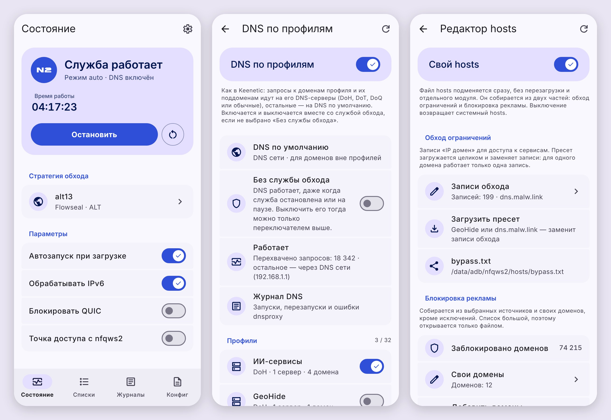
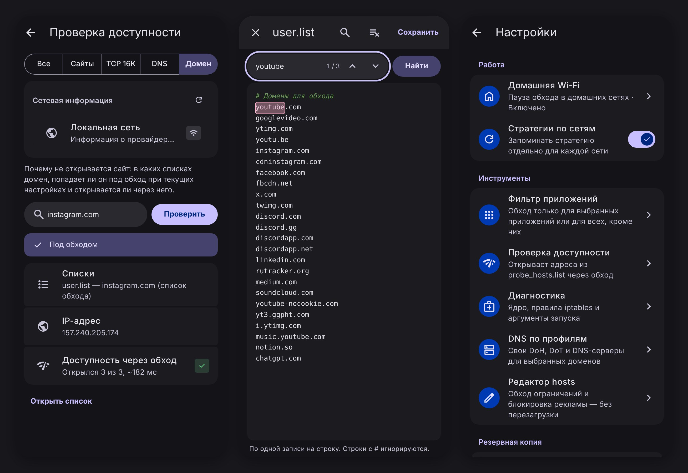

# nfqws2-android-ext

Полнофункциональный порт **nfqws2** ([zapret2](https://github.com/bol-van/zapret) от bol-van) с поддержкой синтаксиса стратегий Keenetic для Android.

Модуль предназначен для обхода ТСПУ/DPI **нативно на уровне ядра** через подсистему `netfilter` (NFQUEUE). В отличие от VPN-приложений (V2Ray, ByeDPI и др.), этот метод **не создает виртуального сетевого интерфейса (tun)**, не расходует дополнительный заряд батареи и не режет скорость соединения.

> **Это форк** [nfqws2-android](https://github.com/Dea1hwa1cher/nfqws2-android) от deathwatcher: всё, что умеет оригинал, плюс **DNS по профилям** на основе [AdGuard dnsproxy](https://github.com/AdguardTeam/dnsproxy) и собственные исправления. Вопросы по форку — в [Issues](../../issues), а не в чат оригинального проекта.

---

## ⚡ Особенности

* **Нативная работа через NFQUEUE**: модификация пакетов «на лету» без поднятия локального VPN-сервиса.
* **Поддержка LuaJIT и Blobs**: полная совместимость со сложными стратегиями (fake, multisplit, multidisorder, circular, payload modifications).
* **Готовые стратегии по группам**: Flowseal ALT, FAKE TLS AUTO, SIMPLE FAKE и авторские пресеты. Любую можно отредактировать прямо в WebUI и в один тап вернуть к исходнику.
* **Импорт конфигов nfqws2-keenetic**: файлы приводятся к виду встроенных стратегий и появляются в выборе стратегии. Можно импортировать сразу несколько.
* **Пауза в домашней Wi‑Fi сети**: если ваш роутер уже обходит DPI, модуль можно настроить на автоотключение в домашней сети.
* **Фильтрация приложений**: обход только для выбранных приложений или для всех, кроме них.
* **Журналы с краткой статистикой**: запуски, автоперезапуски, ошибки и домены, которые модуль сам добавил в `auto.list`. Фильтр «Ошибки» и подсветка синтаксиса.
* **Резервная копия**: конфиг, списки, стратегии и оформление — одним архивом в `Download/nfqws2`.
* **Обновления модуля из менеджера**: KernelSU, Magisk и APatch сами покажут, что вышла новая версия.
* **Полноценный WebUI на Material 3**: светлая, тёмная и AMOLED-тема, выбор акцента с обоев или на цветовом круге, русский и английский язык. Работает из менеджера (KernelSU / APatch) или через MMRL / KsuWebUI.

## 🌐 DNS по профилям

Настройки → Инструменты → **DNS по профилям**. Профиль — это DNS-серверы и домены: запросы к этим доменам и всем их поддоменам идут на серверы профиля, остальные — на «DNS по умолчанию» (DNS текущей сети или любой профиль).

* **Типы серверов**: DoH, DoH3, DoT, DoQ, обычный DNS (по IP: запрос по UDP, длинный ответ — по TCP, как в Keenetic), DNS-штампы `sdns://`. До 8 серверов в профиле — запросы распределяются между ними, а если ни один не ответил, уходят на DNS сети.
* **Домены**: до 1000 в профиле, по одному или сразу списком; адреса вида `https://www.site.com/…` и `*.site.com` приводятся к домену, кириллические — к punycode.
* **Пресеты**: XBox DNS, Comss.one DNS и GeoHide DNS — каждый с DoH, DoT и обычными адресами. Пресет становится обычным профилем: добавьте в него домены или сделайте DNS по умолчанию, меняйте и удаляйте как свой.
* **Проверка домена** прямо из WebUI: в какой адрес он резолвится и через какой профиль.
* **«Частный DNS» Android** (DoT в настройках сети) идёт мимо модуля — если он включён, WebUI предупредит и откроет настройки.

По умолчанию DNS включается и выключается вместе со службой обхода. С переключателем **«Без службы обхода»** он работает и когда служба остановлена или на паузе в домашней Wi‑Fi — выключить его тогда можно только главным переключателем на экране DNS.

Запросы телефона заворачиваются правилом iptables в локальный dnsproxy, а его собственные запросы к серверам уходят в сеть напрямую. Если dnsproxy упадёт, watchdog поднимет его заново; при смене сети DNS сети определяется заново.

## 📋 Требования к системе

1. Установленный **KernelSU**, **APatch** или **Magisk** (v24+).
2. Архитектура процессора: **ARM64** (`arm64-v8a`), **ARM** (`armeabi-v7a`), **x86**, **x86_64**.

## 📥 Установка

1. Скачайте последний `.zip` архив из раздела [Releases](../../releases/latest).
2. Установите модуль через менеджер (KernelSU Manager, Magisk App или APatch).
3. Перезагрузите устройство.
4. Служба запустится автоматически при загрузке системы.

## 🔀 Переход с nfqws2-android

У форка свой id модуля (`nfqws2-android-ext`), а настройки, списки и стратегии — те же (`/data/adb/nfqws2`), поэтому переход ничего не сбрасывает. Два модуля сразу работать не могут: при установке форк отключает оригинальный `nfqws2-android`, после перезагрузки его можно удалить в менеджере. Вернуться — включить оригинал и удалить форк.

---

## 🤝 Благодарности

* [Dea1hwa1cher](https://github.com/Dea1hwa1cher) — автору [nfqws2-android](https://github.com/Dea1hwa1cher/nfqws2-android), на котором построен этот форк.
* [AdGuard dnsproxy](https://github.com/AdguardTeam/dnsproxy) — резолвер для DNS по профилям.
* [bol-van](https://github.com/bol-van) — за оригинальный и непревзойденный проект zapret.
* [nfqws2-keenetic](https://github.com/nfqws/nfqws2-keenetic) — за идеи адаптации конфигов и логику авто-стратегий.
* [dpi-detector](https://github.com/Runnin4ik/dpi-detector) — за алгоритмы детекции и классификации блокировок DPI.
* [nfqws-menu](https://github.com/rndnaame/nfqws-menu) — за стратегии, блобы и списки адресов хостингов.
* [bindhosts](https://github.com/bindhosts/bindhosts) — за множество референсов и идей.
* Разработчикам [KernelSU](https://github.com/tiann/kernelSU), [Magisk](https://github.com/topjohnwu/magisk) и [APatch](https://github.com/bmax121/APatch).
